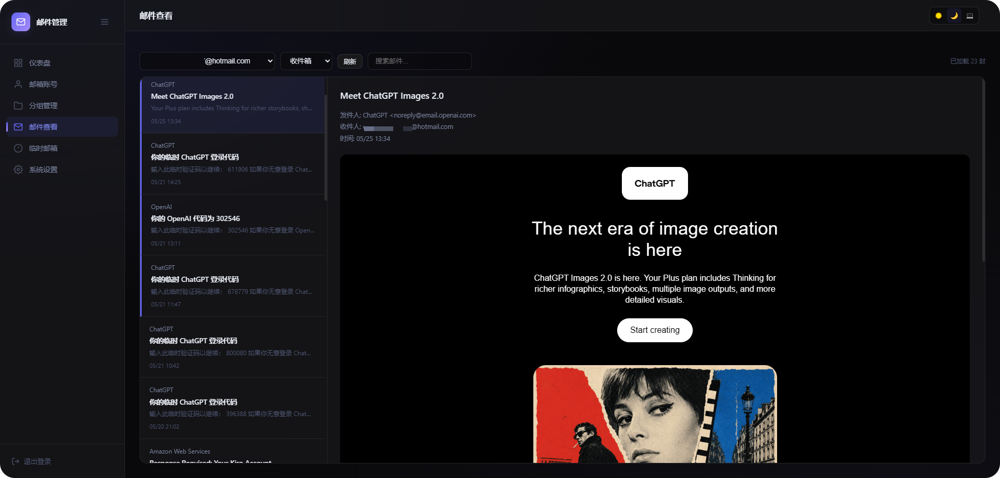
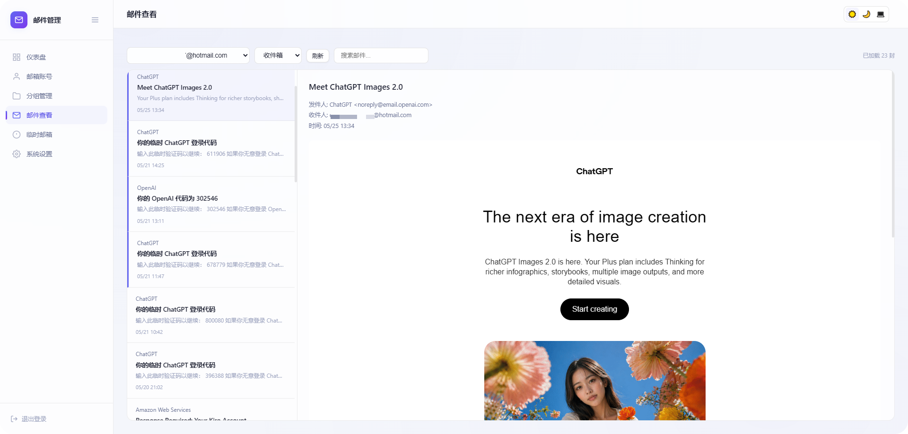

# 📬 Outlook 邮件管理工具 (Docker 独立部署版)

<div align="center">

**专为批量管理 Outlook / Hotmail 打造的轻量级 Web 邮箱客户端**

🐳 Docker 一键部署 · 💾 本地 SQLite 自动迁移与持久化 · ⚡ 独立运行免 Cloudflare 账号 · 🌗 深浅主题 · 🔄 Token 自动续期

[](./LICENSE)
[](https://www.docker.com/)
[](https://nodejs.org/)

</div>

---

| 🌙 深色模式 | ☀️ 浅色模式 |
|:---:|:---:|
|  |  |

---

## ✨ 核心特性

- 🐳 **独立 Docker 容器化** — 不依赖任何第三方 Cloudflare 账户与外部云端数据库，纯本地离线 SQLite 持久化。
- 📦 **批量管理** — 支持批量导入/导出 Outlook 凭据（格式：`邮箱----密码----client_id----refresh_token`），多账号一键切换。
- 🔄 **Token 自动保活续期** — 容器内置后台定时任务（每 5 分钟轮询），定时对快过期或最久未使用的 Token 自动发起静默续期。
- 📨 **完整邮件阅读体验** — 实时读取收件箱、垃圾箱、已删除邮件；支持 HTML 富文本渲染与搜索。
- 🔢 **验证码高亮置顶** — 自动智能识别邮件正文中的 4~6 位数字验证码并置顶展示，支持一键点击复制。
- 🤖 **Telegram 新邮件实时推送** — 支持配置 TG Bot Token 与 Chat ID，新邮件到达时自动推送到 Telegram。
- 📭 **临时邮箱** — 支持集成 GPTMail API，随时生成一次性临时邮箱。

---

## 🚀 极速部署教程

只需两步，5 分钟内即可在任意 Linux / VPS 服务器上跑起来：

### 第一步：克隆代码

```bash
git clone https://github.com/noevers/cf-outlook-email-docker.git
cd cf-outlook-email-docker
```

### 第二步：启动服务

```bash
docker compose up -d --build
```

> **启动自动化机制说明**：
> 1. 容器首次启动时会自动从模板生成配置文件，并自动执行数据库建表迁移（`0001_init`, `0002_tags`, `0003_push_state`）。
> 2. 数据库落盘在当前目录的 `./data` 文件夹下，**升级或重启容器数据绝不丢失**。
> 3. 默认访问端口为 **`8787`**，默认后台管理密码为 **`admin123`**。

---

## ⚙️ 环境变量与自定义配置

如果你需要修改登录密码或端口，直接编辑 `docker-compose.yml`：

```yaml
version: '3.8'

services:
  outlook-email:
    build: .
    image: cf-outlook-email:latest
    container_name: outlook-email
    restart: unless-stopped
    ports:
      - "8787:8787"                  # 格式为 "宿主机端口:8787"
    environment:
      - ADMIN_PASSWORD=admin123       # Web 后台登录密码 (建议修改)
      - PORT=8787                     # 容器内监听端口
      # - GPTMAIL_API_KEY=your_key    # 可选：GPTMail 临时邮箱 API Key
    volumes:
      - ./data:/app/data             # SQLite 数据持久化目录
```

修改后重启生效：
```bash
docker compose down
docker compose up -d
```

---

## 📖 使用指南

### 1. 登录面板
浏览器访问：`http://<服务器公网IP>:8787`，输入密码（默认 `admin123`）登录。

### 2. 添加 Outlook 邮箱账号

#### 方式 A：批量导入（最推荐）
点击顶部导航栏的 **「批量导入」**：
- 支持输入多行账号，每行一条。
- 格式：`邮箱----密码----client_id----refresh_token`
  > *注：如果没有邮箱独立密码，密码位可填任意字符占位（如 `123456`）；*  
  > *注：如果使用的是默认 Thunderbird 授权，`client_id` 可留空。*

#### 方式 B：手动单条添加
点击 **「+ 添加账号」**，切换到 **「手动填写」**：
- 填入你的邮箱地址、`Client ID` 与 `Refresh Token` 即可。

---

## ❓ 常见问题排查 (FAQ)

### 1. 提示「AADSTS90023: No applicable permissions were found」？
- **原因**：这是因为点击了网页上的「一键授权」弹窗，而默认的 Client ID（Mozilla Thunderbird）回调地址不包含你的服务器 IP；或者是学校/企业 Office 365 租户限制了第三方权限。
- **解决**：如果你已经有 `client_id` 和 `refresh_token`，**请直接使用「批量导入」或「手动填写」**，无需点击网页一键授权。

### 2. 提示「密码错误」？
- 系统默认密码为 `admin123`。
- 如果在 `docker-compose.yml` 中自定义了 `ADMIN_PASSWORD`，系统会自动以环境变量中的密码为准。

### 3. 如何备份或迁移数据？
- 所有的账号、Token 缓存和设置均完整保存在项目根目录的 `./data` 文件夹内。
- 迁移服务器时，只需打包带走该目录即可无缝还原。
